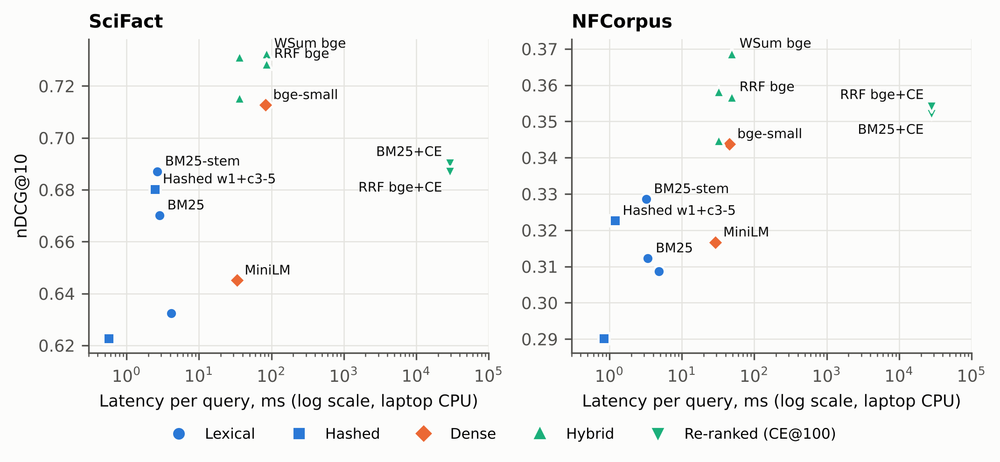

# Lexical, Hashed, Dense and Hybrid Retrieval for Scientific Text

A comparative study of accuracy, latency and memory for 13 retrieval systems on the
BEIR **SciFact** and **NFCorpus** benchmarks.

**Main result:** weighted fusion of stemmed BM25 and `bge-small-en-v1.5` gives the best
nDCG@10 on both datasets (0.733 SciFact, 0.369 NFCorpus) at under 90 ms per query on a
laptop CPU.

## Research questions
1. How do lexical, feature-hashed, dense and hybrid retrievers compare in accuracy on scientific queries?
2. What accuracy is lost or kept when dense embeddings are replaced by cheaper hashed features, and what is saved in latency and index size?
3. Do hybrid fusion and neural re-ranking close the gap, and at what cost?

## Results (nDCG@10)

| Method | SciFact | NFCorpus | Latency (ms/query) | Index (MB, SciFact) |
|---|---|---|---|---|
| BM25 | 0.670 | 0.312 | 2.9 | 4.0 |
| BM25 + stemming | 0.687 | 0.329 | 2.6 | 3.7 |
| Hashed, word 1 + char 3-5 (own) | 0.680 | 0.323 | 2.5 | 65.9 |
| MiniLM-L6 (dense) | 0.645 | 0.317 | 33 | 8.0 |
| bge-small (dense) | 0.713 | 0.344 | 83 | 8.0 |
| RRF, BM25-stem + bge-small | 0.729 | 0.357 | 85 | 11.6 |
| **Weighted fusion, BM25-stem + bge-small** | **0.733** | **0.369** | 85 | 11.6 |
| RRF (bge) + cross-encoder@100 | 0.687 | 0.354 | 29,195 | 11.6 |

All 13 systems, Recall@100, MRR@10, MAP@100, significance tests and ablations are in
[`results_final/`](results_final) and [`results_ablation/`](results_ablation).
Latencies were measured on one laptop (AMD Ryzen, 8 logical cores, no GPU).



## Repository layout

| Path | Contents |
|---|---|
| `irstudy/` | Library: data loading, tokenizer, BM25 / TF-IDF, hashed retriever, dense retrieval, fusion, re-ranking, metrics, significance tests |
| `run_baselines.py` | Lexical and hashed retrievers on both datasets |
| `run_neural.py` | Dense retrievers and cross-encoder scoring (needs the models; slow on CPU) |
| `run_analysis.py` | Fusion, re-ranking depth, significance tests and per-query analysis |
| `scripts/run_hash_ablation.py` | 80-run hashing ablation (bucket count, n-grams, signed hashing) |
| `scripts/dump_failures.py` | Samples failed queries for manual error analysis |
| `make_figures.py`, `make_figures_ieee.py` | Figures used in the report |
| `tests/` | 21 unit tests (metrics vs hand calculation, BM25 vs reference, fusion) |
| `results_final/`, `results_ablation/` | Saved result tables used in the report |
| `figures/` | Report figures |

`results_final/error_categories.csv` holds the manual labels of the 30 sampled failures.

## Reproducing the results

```bash
pip install -r requirements.txt
python -m pytest -q tests                           # 21 tests

# 1. Data: download the BEIR datasets into data/
python scripts/download_beir.py scifact nfcorpus
#    (if the download fails, get scifact.zip and nfcorpus.zip from
#     https://public.ukp.informatik.tu-darmstadt.de/thakur/BEIR/datasets/
#     and unzip them into data/ so that data/scifact/corpus.jsonl exists)

# 2. Lexical and hashed retrievers
python run_baselines.py

# 3. Dense retrievers and cross-encoder scores (several hours on a CPU)
python run_neural.py                                # writes cache/ and results_laptop/

# 4. Analysis, ablation and figures
python run_analysis.py --laptop .
python scripts/run_hash_ablation.py
python make_figures.py
```

Accuracy results are deterministic; latencies depend on the machine.

## Datasets and models
- SciFact (Wadden et al., EMNLP 2020) and NFCorpus (Boteva et al., ECIR 2016), in the
  BEIR format (Thakur et al., NeurIPS 2021). The datasets are not included in this
  repository; download them as shown above.
- Models: `sentence-transformers/all-MiniLM-L6-v2`, `BAAI/bge-small-en-v1.5`,
  `cross-encoder/ms-marco-MiniLM-L-6-v2` (downloaded automatically by `run_neural.py`).

## License
The code in this repository is released under the [MIT License](LICENSE).
The SciFact and NFCorpus datasets and the pretrained models are not part of this
repository and remain under their own licenses and terms of use.
